---
format:
  revealjs:
    css: style.css
    theme: simple
    revealjs-plugins:
      - a11y
      - read-aloud
    revealjs-a11y:
      # The extension's menus introduce ARIA failures; retain our slide-menu handling.
      slide-menu-a11y: false
      menu: false
      # Use the extension's core accessibility fixes without extra UI/shortcuts.
      font-size-controls: false
      font-selection: false
      text-spacing: false
      transcript: false
      slide-change-cue: false
    slide-number: true
    code-line-numbers: false
    preview-links: auto
    keyboard: true
    touch: true
    help: true
    include-in-header: meta-tags.html
    include-after-body: accessibility.html
    link-external-newwindow: true
keywords: ["academia", "industry", "career transition", "professional development"]
description-meta: "A comprehensive guide for making the transition from academic career to industry. Learn how to translate your skills, network effectively, and successfully navigate the career change from academia to tech and other industries."
license: "CC0 1.0 Universal"
pagetitle: "From Academia to Industry"
author-meta: "Indrajeet Patil"
date-meta: "2025-12-05"
lang: "en"
dir: "ltr"
image: "media/social-media-card.webp"
image-alt: "Illustration of an academic graduate stepping toward an industry professional carrying a briefcase"
canonical-url: "https://www.indrapatil.com/academia-to-industry/"
jupyter: python3
---

## From Academia to Industry {#section .center}

:::: {.deck-cover style="text-align: center;"}

::: {.cover-heading}
[From Academia to Industry]{.cover-title}

[A Practical Guide for Making the Transition]{.cover-subtitle}
:::

::: {.cover-visual}
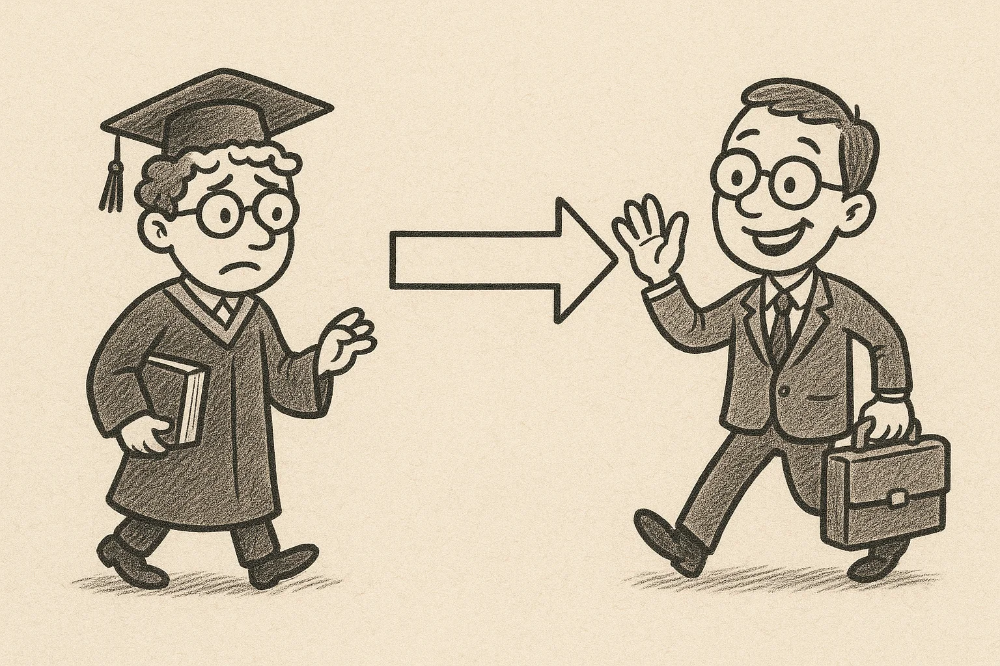{.cover-art width="350" fig-alt="Illustration of an academic graduate stepping toward an industry professional carrying a briefcase"}
:::

::: {.cover-meta}
[Indrajeet Patil]{.cover-author} | [2025-12-05]{.cover-date}
:::

::::

::: {.notes}
Welcome. Moving from academia to industry can be daunting, but it does not mean starting again without experience. Research builds analytical and problem-solving skills that can be valuable in a new setting. This guide covers reflection, skill translation, networking, applications, and the practical work of making that transition.
:::

## Why This Guide?

:::: {.columns}
::: {.column width='60%'}
:::{.callout-note title="Academic Training is Valuable"}
Your research skills and analytical thinking are **highly sought after** in industry
:::

:::{.callout-important title="But Translation is Key"}
Industry requires different approaches and communication styles
:::
:::

::: {.column width='40%'}
:::{style="background-color: #A9F5A9; padding: 15px; border-radius: 20px; text-align: center;"}
**This guide bridges that gap**

- Practical strategies  
- Skill translation  
- Networking approaches
:::
:::
::::

::: {.notes}
There are more researchers seeking long-term academic posts than there are such posts available. Choosing another setting for your work is a legitimate career decision. The useful question is which kind of work and environment will suit your skills and priorities.
:::

---

## My Journey {#section-1 .smaller}

:::{style="background-color: #fffdf8; padding: 20px; border-radius: 11px; border: 1px solid rgba(16, 42, 67, 0.2); box-shadow: 6px 6px 0 rgba(16, 42, 67, 0.12); margin: 15px 0;"}

:::: {.columns}
::: {.column width='50%'}
**📍 My Journey**

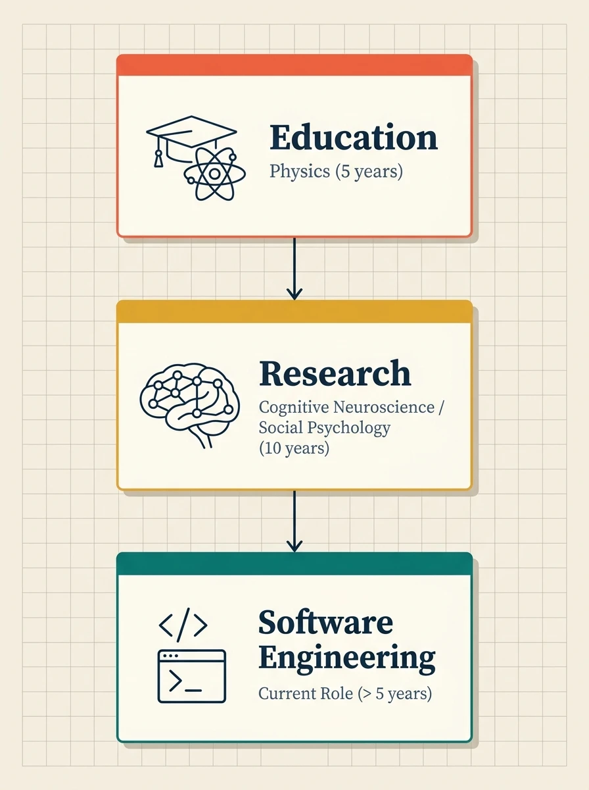{fig-alt="Flowchart showing career transition from Education in Physics (5 years), to Research in Cognitive Neuroscience and Social Psychology (10 years), to current role in Software Engineering (> 5 years)"}
:::

::: {.column width='50%'}
**🎯 Why I Can Help**

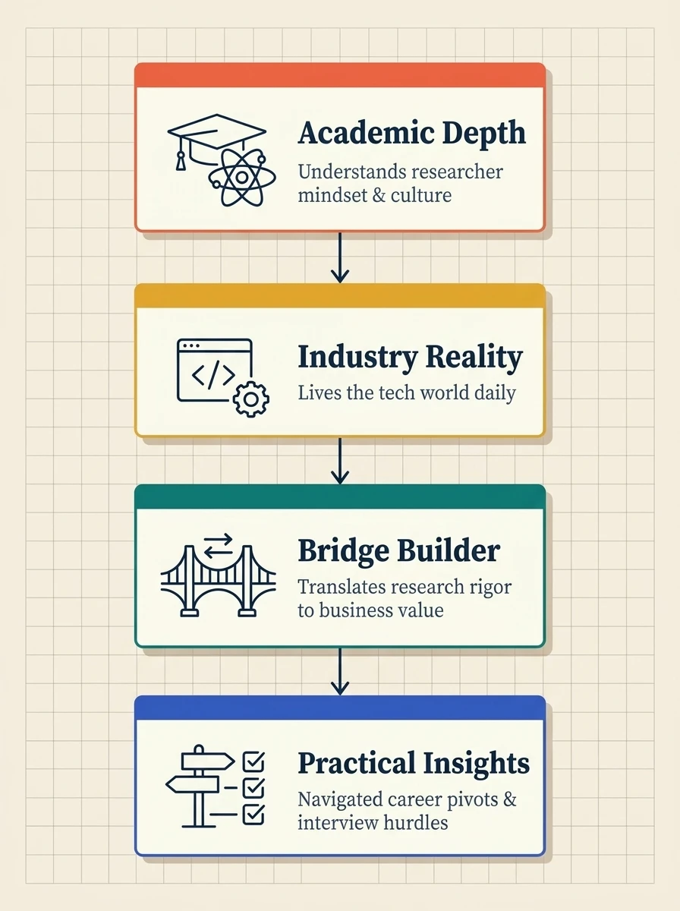{fig-alt="Infographic highlighting four key strengths: Academic Depth (understands researcher mindset and culture), Industry Reality (lives the tech world daily), Bridge Builder (translates research rigour to business value), and Practical Insights (navigated career pivots and interview hurdles)"}
:::
::::

:::{style="background-color: #e2e9ff; padding: 12px; border-radius: 11px; margin-top: 15px; text-align: center; border: 1px solid rgba(16, 42, 67, 0.15);"}
**💡 My goal:** Sharing actionable insights from experience
:::

:::

::: {.notes}
My own move from cognitive science research into software engineering and data science brought both a learning curve and a change in perspective. This talk draws on that transition: the adjustments, the mistakes, and the approaches I found useful.
:::

---

## What We'll Cover {.smaller}

- [**Self-Assessment**]{.agenda-title} [Know your why and identify your strengths]{.agenda-detail}
- [**Skill Translation**]{.agenda-title} [Communicate your value in business terms]{.agenda-detail}
- [**Strategic Networking**]{.agenda-title} [Build meaningful industry connections]{.agenda-detail}
- [**Application Strategy**]{.agenda-title} [Present yourself effectively to employers]{.agenda-detail}

:::{.agenda-goal}
**Goal:** *Successfully transition from academia to industry with confidence and clarity*
:::

::: {.notes}
We will begin with self-assessment, then translate research experience into the language of potential roles. We will look at networking and applications, consider common mistakes, and finish with principles that bring the process together.
:::

# Self-Assessment {data-section-marker="01"}

::: {.notes}
Before updating a CV or choosing job titles, take time to consider what you want from your working life. That reflection makes later choices more focused.
:::

## Know Your "Why" {.smaller}

:::: {.columns}
::: {.column width='60%'}
**What energises you in your current work?**

- Research and discovery
- Problem-solving challenges
- Data analysis and interpretation
- Teaching and mentoring
- Project leadership
- Writing and communication

*Your enjoyment patterns directly inform which industry roles will be the best fit*
:::

::: {.column width='40%'}
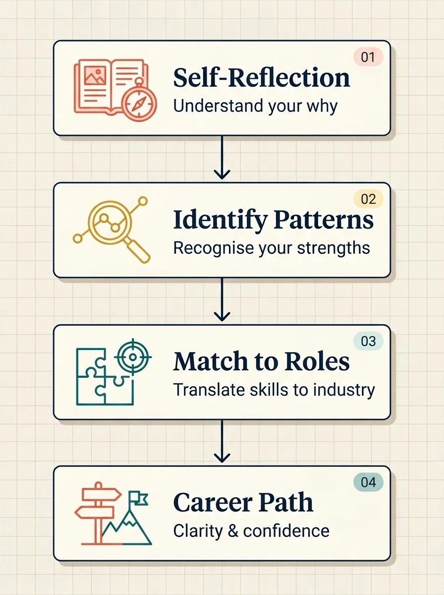{fig-alt="Flowchart illustrating the career transition process: Self-Reflection to understand your why, Identify Patterns to recognise strengths, Match to Roles to translate skills to industry, and Career Path for clarity and confidence"}
:::
::::

::: {.notes}
What is pushing you away from academia, and what is attracting you to another setting? Location, compensation, working patterns, collaboration, and the kind of impact you want may all matter. Separating those motivations helps you evaluate a role beyond its title.
:::

---

## Example Pathways {.smaller}

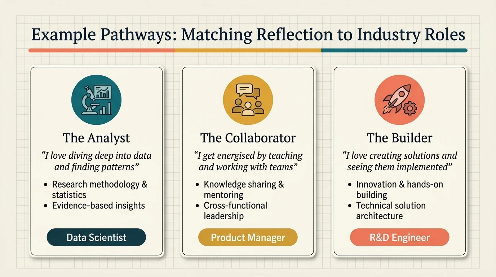{fig-alt="Infographic showing three example career pathways matching personal reflection to industry roles: The Analyst (focus on data and patterns, leading to Data Scientist), The Collaborator (focus on teaching and teamwork, leading to Product Manager), and The Builder (focus on practical solutions, leading to R&D Engineer)"}

::: {.notes}
Researchers can move in several directions. Quantitative work can connect with data science and analytics; experimental work with user research; computational work with software or data engineering. Writing and teaching can also support technical communication and developer education. These are possibilities to explore, rather than fixed routes for a particular discipline.
:::

# Skill Translation {data-section-marker="02"}

::: {.notes}
Skill translation is about making your existing experience understandable to the people hiring for a different kind of role.
:::

## Your Transferable Skills {.smaller}

| **Academic Skill** | **Industry Translation** |
|-------------------|-------------------------|
| Critical thinking | Strategic problem-solving |
| Scientific method | Hypothesis-driven decisions |
| Literature review | Competitive analysis |
| Grant writing | Business case development |
| Peer review | Quality assurance |
| Teaching | Knowledge transfer |
| Project management | Initiative leadership |

::: {.notes}
Research involves framing ambiguous problems, evaluating evidence, analysing data, and managing projects. Those abilities can transfer, but the connection may not be obvious from an academic job title. Explain what you did, the decisions you made, and the result.
:::

## Academic vs. Industry Mindset {.smaller}

| **Aspect** | **Academic World** | **Industry World** |
|-----------|-------------------|-------------------|
| **Timeline** | Long-term cycles | Fast iterations |
| **Success** | Publications, citations | Revenue, user impact |
| **Communication** | Technical, detailed | Clear, actionable |
| **Collaboration** | Individual expertise | Cross-functional teams |
| **Risk** | High (breakthrough research) | Calculated (business ROI) |

::: {.notes}
Academic and commercial environments often reward different things. A business project may place greater weight on delivery, collaboration, and an adequate solution within a deadline. The task is to understand the role's expectations while retaining the rigour that makes your work reliable.
:::

## Business-Minded Questions {.smaller}

:::{style="text-align: center; background-color: #E6F3FF; padding: 20px; border-radius: 20px; margin-bottom: 20px;"}
**🎯 Every idea in industry must answer these fundamental questions**
:::

:::: {.columns}
::: {.column width='35%'}
:::{.callout-important title="💰 Revenue Impact" icon=false}

- Will this generate revenue?
- How much investment is required?
- What's the expected ROI?
- Who pays for this?

:::
:::

::: {.column width='30%'}
:::{.callout-note title="⚡ Feasibility" icon=false}

- Can we actually build this?
- Do we have the resources?
- What are the risks?
- How long will it take?

:::
:::

::: {.column width='35%'}
:::{.callout-tip title="📈 Business Value" icon=false}

- Does this solve a real problem?
- How many users will benefit?
- Will customers pay for this?
- Does it align with strategy?

:::
:::
::::

:::{style="background-color: #F8F9FA; padding: 20px; border-radius: 15px; text-align: center; margin-top: 20px;"}
**🔄 Decision Framework**

[**💡 Idea** → **💰 Revenue?** → **⚡ Feasible?** → **📈 Value?** → **✅ Proceed** or **❌ Pivot**]{style="font-size: 0.8em;"}
:::

::: {.notes}
Connect a technical decision with the problem it solves. Does it reduce a cost, improve an experience, or save time? Describing that link helps another team understand why your work matters, without assuming they share your research background.
:::

## The Art of Translation {.smaller}

:::: {.columns}
::: {.column width='50%'}
:::{.callout-caution title="❌ Academic Language" icon=false}
*"Investigated variables X and Y using statistical modeling"*

**Problems:**

- Too technical
- No business impact
:::
:::

::: {.column width='50%'}
:::{.callout-tip title="✅ Business Language" icon=false}
*"Analyzed customer data, leading to 15% retention improvement"*

**Strengths:**

- Clear business impact
- Quantified results
:::
:::
::::

:::{style="background-color: #FFFACD; padding: 15px; border-radius: 20px; text-align: center; margin-top: 15px;"}
 Academic Skill + Business Context + Impact = Value
:::

::: {.notes}
Translate the substance of an achievement, rather than replacing academic words with business jargon. A paper may demonstrate clear communication of complex evidence. A grant may involve budget and project responsibility, and teaching may involve mentoring. Use only responsibilities and outcomes that accurately describe your own experience.
:::

## Role-Specific Translations {.smaller}

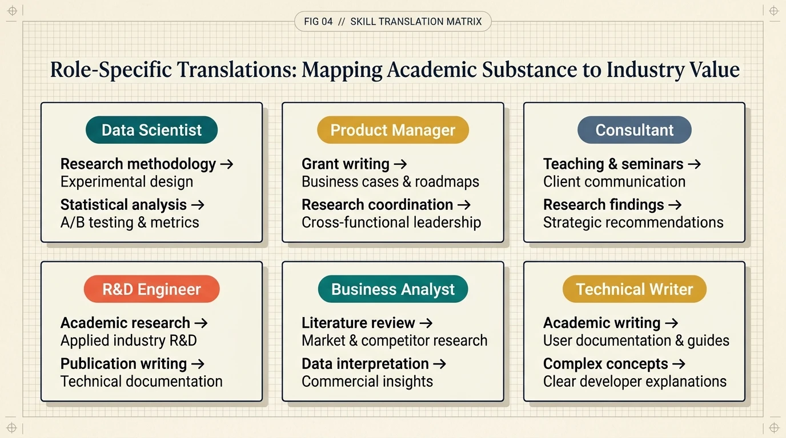{fig-alt="Matrix infographic illustrating academic skill translations for six industry roles: Data Scientist (experimental design and A/B testing), Product Manager (business cases and cross-functional leadership), Consultant (client communication and strategic recommendations), R&D Engineer (applied industry R&D and technical documentation), Business Analyst (market research and commercial insights), and Technical Writer (user documentation and clear developer explanations)"}

::: {.notes}
The emphasis should change with the target role. For data science, statistical reasoning and data quality may be central. For software engineering, collaboration, testing, architecture, and deployment may matter more. Choose examples that show the capabilities the role actually needs.
:::

## Critical Upskilling Areas {.smaller}

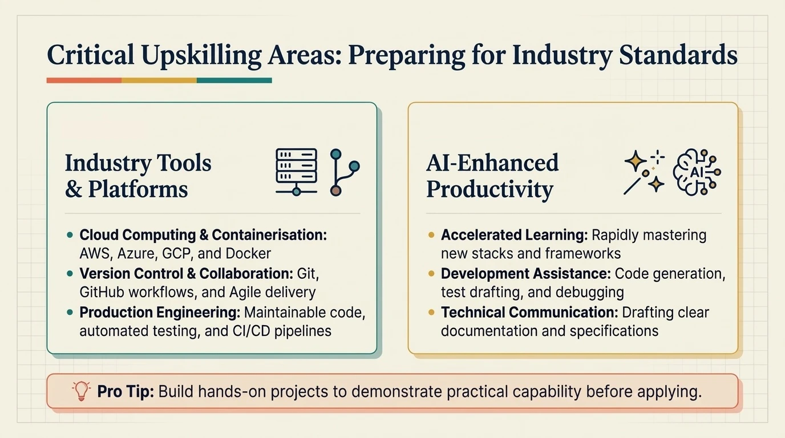{fig-alt="Editorial infographic detailing critical upskilling areas for transitioning researchers: Industry Tools and Platforms (cloud computing, containerisation, version control, and production engineering) and AI-Enhanced Productivity (accelerated learning, development assistance, and technical communication), with a pro tip emphasizing hands-on projects"}

::: {.notes}
Identify practical gaps that would prevent you from doing the work. These might include Git collaboration, automated testing, databases, deployment tools, or communication with non-specialists. A focused project can help you practise those skills and provide concrete evidence of them.
:::

# Strategic Networking {data-section-marker="03"}

::: {.notes}
Networking is a way to learn about unfamiliar work and build professional relationships. It is easier to approach when the goal is a useful conversation rather than an immediate job request.
:::

## Why Networking Matters {.smaller}

:::{style="text-align: center; background-color: #FFE4B5; padding: 20px; border-radius: 15px; margin-bottom: 20px;"}
**70% of jobs are never posted publicly**
:::

:::: {.columns}
::: {.column width='60%'}
:::{style="background-color: #F0F8FF; padding: 15px; border-radius: 10px; font-size: 0.9em;"}
**The Hidden Job Market**

- Companies hire through referrals first
- Positions filled before posting
- Internal candidate recommendations
- Networking events and connections
:::
:::

::: {.column width='40%'}
:::{style="background-color: #E8F5E8; padding: 15px; border-radius: 10px; font-size: 0.9em;"}
**Why Networking Works**

- Inside knowledge of roles
- Referrals get noticed
- Learn company culture
- Skip the application pile
:::
:::
::::

:::{style="font-size: 0.6em; text-align: center; margin-top: 15px;"}
Source: [The Interview Guys: The Hidden Job Market](https://blog.theinterviewguys.com/the-hidden-job-market/){style="text-decoration: underline;"}
:::

::: {.notes}
A conversation can reveal roles, expectations, and opportunities that a job advertisement does not explain. A referral may help an application reach the right person, but it is not a guarantee. Understanding the work is valuable even when a conversation does not lead directly to an application.
:::

## Strategic Networking Plan {.smaller}

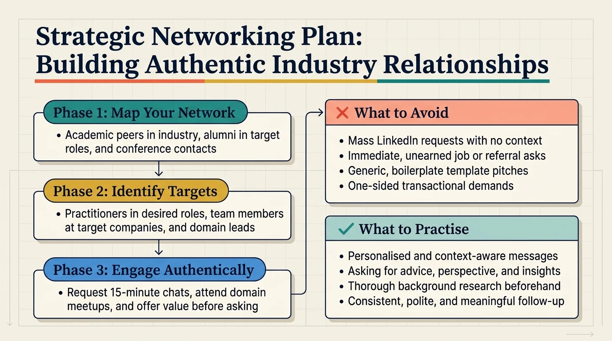{fig-alt="Infographic showing a 3-phase strategic networking progression: Phase 1 (Map Your Network), Phase 2 (Identify Targets), and Phase 3 (Engage Authentically), accompanied by comparison cards detailing What to Avoid (mass messages and immediate job asks) and What to Practise (personalised outreach, asking for advice, and consistent follow-up)"}

::: {.notes}
Start with people who share some context: former colleagues, alumni, user groups, or an open source community. Ask about their work and listen to the differences from your own experience. A small number of thoughtful conversations is a manageable starting point.
:::

## LinkedIn Outreach Examples {.smaller}

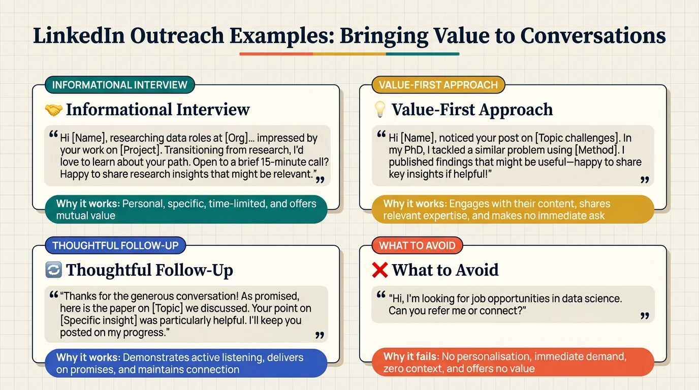{fig-alt="Editorial infographic presenting four LinkedIn outreach templates and patterns without tabs: Informational Interview (personal, specific, and offering reciprocal value), Value-First Approach (engaging with content and offering domain insights), Thoughtful Follow-Up (delivering promised resources and maintaining contact), and What to Avoid (generic pitches and immediate referral requests)"}

::: {.notes}
Keep an initial message concise, specific, and respectful of the other person's time. An informational conversation is a chance to learn, not a disguised demand for a referral. Thank the person afterwards and follow up when you have a meaningful update. Mass messages and unrequested attachments usually make the exchange less useful.
:::

# Application Strategy {data-section-marker="04"}

::: {.notes}
The application stage turns that preparation into a clear account of why you fit a particular role. A research CV usually needs reshaping for this audience.
:::

## Crafting Your Story {.smaller}

:::{style="background-color: #F0F8FF; padding: 15px; border-radius: 20px; text-align: center;"}
**📖 Four-Part Structure**
:::

:::: {.columns}
::: {.column width='50%'}
**1. Context** → Academic background  
**2. Catalyst** → Why changing  
**3. Connection** → Skills transfer  
**4. Commitment** → Industry dedication
:::

::: {.column width='50%'}
:::{.callout-tip title="Example"}
*"After researching user behaviour, I'm excited to improve real-world digital experiences using my statistical expertise."*
:::
:::
::::

:::{.callout-important title="⚠️ Critical" icon="false"}
Focus on attraction TO industry, not escape FROM academia
:::

::: {.notes}
Prepare a positive explanation of the move. What attracts you to this work, and how does your experience connect with it? A clear answer gives the interviewer a direction to explore instead of leaving them to infer your motivation from the fact that you are leaving academia.
:::

## Resume Transformation {.smaller}

:::: {.columns}
::: {.column width='50%'}
:::{.callout-caution title="🗑️ Remove" icon=false}

- Publication lists (retain key ones for R&D positions)
- Conference presentations
- Teaching responsibilities
- Academic honors
:::
:::

::: {.column width='50%'}
:::{.callout-tip title="✅ Add" icon=false}

- Business impact metrics
- Technical skills/tools
- Project leadership
- Cross-functional collaboration
:::
:::
::::

:::{style="background-color: #FFF8DC; padding: 10px; border-radius: 15px; text-align: center; margin-top: 15px;"}
💡 **Pro Tip**: Apply even if you meet 60-70% of requirements!
:::

::: {.notes}
A concise industry CV should make the most relevant experience easy to find. Lead with useful skills and concrete outcomes, and reduce material that does not help assess the role. Publications can be summarised when the full bibliography is less relevant than the work it demonstrates.
:::

## Interview Types {.smaller}

:::: {.columns}
::: {.column width='50%'}
:::{.callout-note title="🗣️ Behavioural" icon=false}
**STAR Method** (Situation, Task, Action, Result)

- Leadership examples
- Conflict resolution
:::

:::{.callout-note title="🧠 Technical" icon=false}

- Domain knowledge
- Problem-solving approach
:::
:::

::: {.column width='50%'}
:::{.callout-note title="📊 Case Study" icon=false}

- Business scenario analysis
- Strategic recommendations
:::

:::{.callout-note title="🤝 Culture Fit" icon=false}

- Team collaboration
- Values alignment
:::
:::
::::

::: {.notes}
Interview processes vary, but often begin with a recruiter conversation and continue through practical and technical assessments. Later rounds may explore design, collaboration, and examples of past decisions. Ask about the process so you can prepare for the format you will actually encounter.
:::

## Common Questions {.smaller}

:::: {.columns}
::: {.column width='50%'}
:::{.callout-important title="Why leave academia?"}

**✅ Good:**
"Apply research skills to real-world problems impacting users"

**❌ Avoid:**
Complaining about academic politics
:::
:::

::: {.column width='50%'}
:::{.callout-important title="Describe teamwork"}

**Academic Examples:**

- Multi-disciplinary projects
- Conference organisation
- Cross-institutional collaboration

**Frame as:** Project management, stakeholder coordination
:::
:::
::::

::: {.notes}
Behavioural questions often ask about conflict, deadlines, priorities, or communication. A clear structure is situation, task, action, and result. Explain your own contribution and what you learned, rather than describing only what the wider team did.
:::

## Timeline Expectations {.smaller}

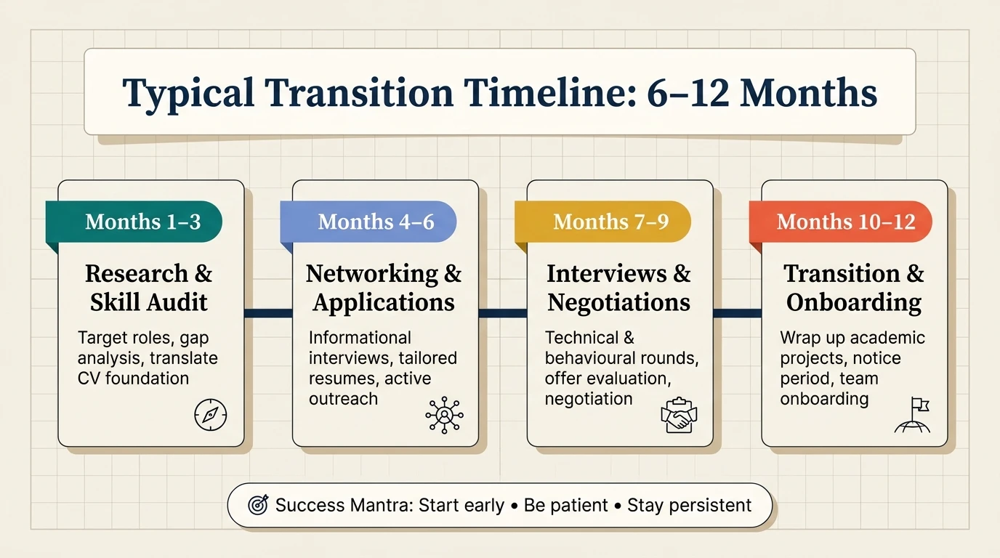{fig-alt="Roadmap infographic illustrating a typical 6 to 12 month transition timeline across four sequential phases: Months 1 to 3 for Research and Skill Audit, Months 4 to 6 for Networking and Applications, Months 7 to 9 for Interviews and Negotiations, and Months 10 to 12 for Transition and Onboarding, ending with the Success Mantra: Start early, be patient, and stay persistent"}

::: {.notes}
Allow time for reflection, preparation, applications, and the eventual move. The six-to-twelve-month range on this slide is a planning illustration, not a deadline for success. Use feedback from interviews to refine your examples and identify what needs more preparation.
:::

## Managing Transition

:::: {.columns}
::: {.column width='33%'}
:::{.callout-note title="💰 Financial" icon=false}

- 6-12 months expenses
- Consider consulting
- Negotiate start dates
:::
:::

::: {.column width='33%'}
:::{.callout-note title="🧠 Emotional" icon=false}

- Identity shift takes time
- Imposter syndrome normal
- Build support networks
:::
:::

::: {.column width='33%'}
:::{.callout-note title="📚 Skills" icon=false}

- Industry tools
- Business courses
- Professional certifications
:::
:::
::::

::: {.notes}
A career change can affect identity as well as daily work. Mixed feelings do not mean the decision is wrong. Recognising progress and talking with others who have made a similar move can make the transition less isolating.
:::

## What You'll Enjoy vs. Miss {.smaller}

:::: {.columns}
::: {.column width='50%'}
:::{style="background-color: #E8F5E8; padding: 15px; border-radius: 10px;"}
**What You'll Enjoy**

- Immediate impact
- Clear objectives  
- Collaborative teams
- Better resources
- Career progression
:::
:::

::: {.column width='50%'}
:::{style="background-color: #FFE4E1; padding: 15px; border-radius: 10px;"}
**What You Might Miss**

- Deep exploration
- Academic freedom
- Knowledge creation
- Publication prestige
- Conference travel
:::
:::
::::

::: {.notes}
A different setting brings trade-offs. Compensation, schedules, and shared responsibility may improve, while the degree of research autonomy and the pace of projects may change. Consider those differences in the context of the particular team and role.
:::

# Common Mistakes {data-section-marker="05"}

::: {.notes}
Several recurring mistakes can make the transition harder. Recognising them early helps you choose a more deliberate approach.
:::

## Underestimating Your Value {.smaller}

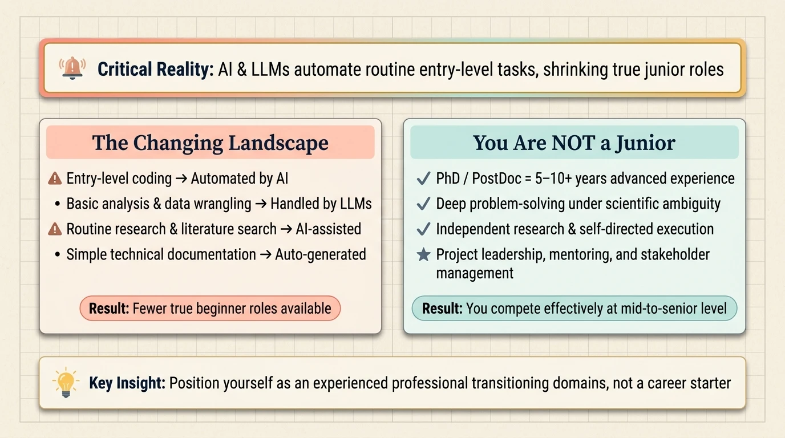{fig-alt="Editorial infographic contrasting AI automation with advanced academic capabilities: top alert highlights AI reducing true junior roles, left card shows the changing landscape with automated entry-level coding and analysis, right card emphasises that researchers compete at mid-to-senior levels with 5 to 10 plus years of deep experience, and bottom banner advises positioning oneself as an experienced professional transitioning domains"}

::: {.notes}
Do not assume that the absence of an industry title makes all of your experience entry-level. Research may have given you substantial responsibility and analytical depth. Equally, assess any practical gaps honestly and choose a role that fits the evidence of what you can do.
:::

## Poor Salary Negotiation {.smaller}

:::: {.columns}
::: {.column width='50%'}
:::{.callout-tip title="📊 Research Tools" icon=false}

**Salary Data Sources:**

- Glassdoor, Levels.fyi
- PayScale, Salary.com
- LinkedIn Salary Insights

**Consider:**

- Base salary + bonuses
- Stock options/equity
- Benefits package

:::
:::

::: {.column width='50%'}
:::{.callout-important title="🎯 Negotiation Strategy" icon=false}

**Academic → Industry Reality:**

- Industry can pay 2-3x academic salaries
- Total compensation matters
- Room for negotiation exists

**Timing:**

- Wait for offer before discussing salary
- Express enthusiasm first
- Ask for time to consider
:::
:::
::::

:::{style="background-color: #E8F5E8; padding: 15px; border-radius: 15px; margin-top: 15px;"}
**Sample Response:** *"Thank you for the offer! I'm excited about the opportunity. Based on my research and experience, I was expecting a range of $X-Y. Could we please discuss the compensation package?"*
:::

::: {.notes}
Before discussing an offer, understand the role's compensation range and the components of the package. Base salary, bonus, and equity are different things. Prepare for the conversation and explain your expectations professionally, rather than treating an academic salary as the only reference point.
:::

## Industry Misconceptions {.smaller}

:::: {.columns}
::: {.column width='50%'}
:::{.callout-caution title="❌ Harmful Assumptions" icon=false}

**"Industry is less intellectual"**

- Assumes academic work is inherently superior
- Ignores complex business problems
- Overlooks innovation in industry R&D

**"It's all about profit"**

- Misses impact-driven roles
- Ignores social good companies
- Oversimplifies business motivations
:::
:::

::: {.column width='50%'}
:::{.callout-tip title="✅ Reality Check" icon=false}

**Industry offers:**

- Complex, multifaceted challenges
- Cutting-edge research opportunities
- Real-world impact at scale
- Diverse problem-solving approaches

**Many companies prioritise:**

- Social impact and sustainability
- Employee development and learning
- Innovation and breakthrough research
:::
:::
::::

:::{style="background-color: #E6F3FF; padding: 15px; border-radius: 15px; text-align: center; margin-top: 15px;"}
**💡 Reframe**: Industry work offers different but equally intellectually stimulating challenges
:::

::: {.notes}
Industry roles differ widely in their intellectual demands and working cultures. Some involve substantial research and difficult engineering problems. Evaluate the actual work and team rather than assuming that every commercial role shares the same strengths or limitations.
:::

## Shotgun Application Strategy {.smaller}

:::: {.columns}
::: {.column width='50%'}
:::{.callout-caution title="❌ Shotgun Approach" icon=false}

**What it looks like:**

- 100+ generic applications
- Same resume for every role
- Copy-paste cover letters
- No company research

**Why it fails:**

- Lacks genuine interest
- Misses role-specific requirements
- Shows no cultural fit
:::
:::

::: {.column width='50%'}
:::{.callout-tip title="✅ Strategic Targeting" icon=false}

**Better approach:**

- Research 10-15 target companies
- Customise applications for each role
- Connect with employees first
- Understand company values

**Quality over quantity:**

- Higher response rates
- Better interview preparation
- Genuine enthusiasm shows
:::
:::
::::

:::{style="background-color: #E8F5E8; padding: 15px; border-radius: 15px; text-align: center; margin-top: 15px;"}
**💡 Rule of thumb**: Spend 2-3 hours researching and customizing each application rather than sending 20 generic ones
:::

::: {.notes}
A large volume of generic applications can consume a great deal of effort without teaching you much. A focused list gives you more time to understand each role, tailor the evidence in your CV, and build relevant connections. Treat the numbers on the slide as an example of focus, rather than a formula that guarantees an offer.
:::

# Summary {data-section-marker="06"}

::: {.notes}
Let’s bring the main principles together: communicate your experience clearly, learn about the target environment, and make choices that fit your own priorities.
:::

## Success Principles 

:::{.callout-tip icon=false}

- **Start with self-awareness**
- **Adapt your skills, don't just list them**
- **Network authentically**
- **Apply strategically**
- **Embrace learning**
- **Stay confident**
:::

:::{style="background-color: #FFFACD; padding: 15px; border-radius: 20px; text-align: center; margin-top: 15px;"}
Your academic journey has **perfectly prepared** you for this exciting transition!
:::

::: {.notes}
Translate your skills into outcomes another team can understand. Build relationships through useful conversations, practise the skills the role requires, and be realistic about both your strengths and the gaps. The aim is a good fit, rather than a move at any cost.
:::

## Questions & Discussion

:::{style="text-align: center; font-size: 1.2em; background-color: #F0F8FF; padding: 15px; border-radius: 20px;"}
**What questions do you have?**
:::

:::: {.columns}
::: {.column width='33%'}
:::{style="background-color: #FFE4E1; padding: 15px; border-radius: 15px; text-align: center;"}
🤔 **Challenges**  
What obstacles do you face?
:::
:::

::: {.column width='33%'}
:::{style="background-color: #E8F5E8; padding: 15px; border-radius: 15px; text-align: center;"}
💡 **Insights**  
What resonates most?
:::
:::

::: {.column width='33%'}
:::{style="background-color: #FFF8DC; padding: 15px; border-radius: 15px; text-align: center;"}
🤝 **Support**  
How can we help each other?
:::
:::
::::

::: {.notes}
Questions and discussion are welcome. It can be helpful to compare experiences while recognising that disciplines, locations, and employers create different paths through the transition.
:::

# Thank You {data-section-marker="→"}

Good luck! 😊

 
 

::: {style="text-align: center; font-size: 0.7em;"}

Check out my other [slide decks](https://www.indrapatil.com/presentations/) on software development best practices

:::

::: {style="text-align: center; font-size: 1em;"}

<a class="deck-icon-link" href="https://www.linkedin.com/in/indrajeet-patil-ph-d-397865174/" aria-label="LinkedIn"></a>
&nbsp;&nbsp;
<a class="deck-icon-link" href="https://github.com/IndrajeetPatil" aria-label="GitHub"></a>
&nbsp;&nbsp;
<a class="deck-icon-link" href="mailto:patilindrajeet.science@gmail.com" aria-label="Email"></a>

:::

::: {.notes}
Thank you for listening. I hope this guide gives you a clearer starting point for your next steps. The links on this slide provide ways to get in touch and explore the related resources.
:::
