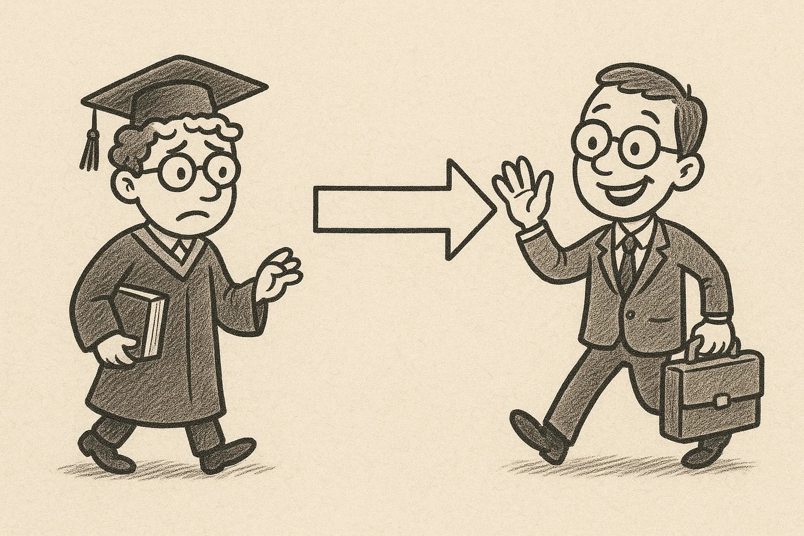

---
format:
  revealjs:
    css: style.css
    theme: simple
    revealjs-plugins:
      - a11y
    revealjs-a11y:
      # 0.2.3's menus introduce ARIA failures; retain our slide-menu handling.
      slide-menu-a11y: false
      menu: false
      # Use the extension's core accessibility fixes without extra UI/shortcuts.
      font-size-controls: false
      font-selection: false
      text-spacing: false
      transcript: false
      slide-change-cue: false
    slide-number: true
    code-line-numbers: false
    preview-links: auto
    keyboard: true
    touch: true
    help: true
    include-in-header: meta-tags.html
    include-after-body: accessibility.html
    link-external-newwindow: true
keywords: ["academia", "industry", "career transition", "professional development"]
description-meta: "A comprehensive guide for making the transition from academic career to industry. Learn how to translate your skills, network effectively, and successfully navigate the career change from academia to tech and other industries."
license: "CC0 1.0 Universal"
pagetitle: "From Academia to Industry"
author-meta: "Indrajeet Patil"
date-meta: "2025-12-05"
lang: "en"
dir: "ltr"
image: "media/social-media-card.webp"
image-alt: "Illustration of an academic graduate stepping toward an industry professional carrying a briefcase"
canonical-url: "https://www.indrapatil.com/academia-to-industry/"
jupyter: python3
---

## From Academia to Industry {#section .center}

:::: {.deck-cover style="text-align: center;"}

::: {.cover-heading}
[From Academia to Industry]{.cover-title}

[A Practical Guide for Making the Transition]{.cover-subtitle}
:::

::: {.cover-visual}
{.cover-art width="350" fig-alt="Illustration of an academic graduate stepping toward an industry professional carrying a briefcase"}
:::

::: {.cover-meta}
[Indrajeet Patil]{.cover-author} | [2025-12-05]{.cover-date}
:::

::::

::: {.notes}
Welcome everyone. Transitioning from academia to industry can feel daunting, but remember: you are not starting your career over from scratch. You are pivoting a wealth of research, analytical, and problem-solving skills into a new commercial context.

This guide provides practical, actionable strategies for navigating every stage of the transition: from mindset shifts and skill translation to networking, interview prep, and salary negotiation.
:::

## Why This Guide?

:::: {.columns}
::: {.column width='60%'}
:::{.callout-note title="Academic Training is Valuable"}
Your research skills and analytical thinking are **highly sought after** in industry
:::

:::{.callout-important title="But Translation is Key"}
Industry requires different approaches and communication styles
:::
:::

::: {.column width='40%'}
:::{style="background-color: #A9F5A9; padding: 15px; border-radius: 20px; text-align: center;"}
**This guide bridges that gap**

- Practical strategies  
- Skill translation  
- Networking approaches
:::
:::
::::

::: {.notes}
Frame the necessity of this guide:
The academic job market has faced structural imbalances for decades. Far more PhDs graduate each year than there are permanent tenure-track professorships available.

Leaving academia is not a failure; it is a healthy, proactive career choice to apply your intellectual capabilities where they are compensated, valued, and positioned for scalable impact.
:::

---

## My Journey {#section-1 .smaller}

:::{style="background-color: #FAFBFC; padding: 30px; border-radius: 15px; border: 2px solid #E1E4E8; margin: 20px 0;"}

:::: {.columns}
::: {.column width='30%'}
**📍 My Journey**

```{mermaid}
flowchart TD
    A["<b>Education</b><br/>Physics<br/>(5 years)"] --> B["<b>Research</b><br/>Cognitive Neuroscience/<br/>Social Psychology<br/>(10 years)"]
    B --> C["<b>Software Engineering</b><br/>Current Role<br/>(&gt; 5 years)"]
    
    style A fill:#F0F8FF,stroke:#4169E1,stroke-width:2px,color:#000000
    style B fill:#F5F0FF,stroke:#8A2BE2,stroke-width:2px,color:#000000
    style C fill:#F0FFF0,stroke:#228B22,stroke-width:2px,color:#000000
```
:::

::: {.column width='70%'}
**🎯 Why I Can Help**

:::{style="font-size: 0.8em; line-height: 1.5; margin-top: 15px;"}
✅ **Multiple career pivots** → Navigated two major field changes  
✅ **Academic depth** → Understand research mindset & culture  
✅ **Industry reality** → Living the tech world daily  
✅ **Bridge builder** → Translate academic ↔ business worlds  
✅ **Fresh experience** → Recent transition, remember struggles  
✅ **Practical insights** → Lived networking & interview process
:::
:::
::::

:::{style="background-color: #E8F4FD; padding: 20px; border-radius: 10px; margin-top: 25px; text-align: center;"}
**💡 My goal:** Sharing actionable insights from experience
:::

:::

::: {.notes}
Share personal context:
Having transitioned from academic cognitive science research into software engineering and data science, I experienced first-hand the disorientation, the learning curve, and ultimately the immense professional satisfaction of working in industry.

This talk crystallises the lessons learned, pitfalls encountered, and strategies that actually work.
:::

---

## What We'll Cover {.smaller}

- [**Self-Assessment**]{.agenda-title} [Know your why and identify your strengths]{.agenda-detail}
- [**Skill Translation**]{.agenda-title} [Communicate your value in business terms]{.agenda-detail}
- [**Strategic Networking**]{.agenda-title} [Build meaningful industry connections]{.agenda-detail}
- [**Application Strategy**]{.agenda-title} [Present yourself effectively to employers]{.agenda-detail}

:::{.agenda-goal}
**Goal:** *Successfully transition from academia to industry with confidence and clarity*
:::

::: {.notes}
Walk through the six main topics we will explore today:
1. Self-Assessment: Uncovering your core motivations and identifying suitable career directions.
2. Skill Translation: Learning to describe academic work in language that hiring managers understand.
3. Strategic Networking: Building genuine professional relationships that lead to opportunities.
4. Application Strategy: Crafting impactful resumes and acing multi-stage interviews.
5. Common Mistakes: Avoiding imposter syndrome, poor negotiation, and application traps.
6. Summary Principles: Key mental models for a smooth transition.
:::

# Self-Assessment {data-section-marker="01"}

::: {.notes}
Introduce Section 1: Self-Assessment. Before updating your resume or applying for jobs, take time to reflect on what you truly want from your professional life.
:::

## Know Your "Why" {.smaller}

:::: {.columns}
::: {.column width='60%'}
**What energises you in your current work?**

- Research and discovery
- Problem-solving challenges
- Data analysis and interpretation
- Teaching and mentoring
- Project leadership
- Writing and communication

*Your enjoyment patterns directly inform which industry roles will be the best fit*
:::

::: {.column width='40%'}
```{mermaid}
flowchart TD
    A[Self-Reflection] --> B[Identify Patterns]
    B --> C[Match to Roles]
    C --> D[Career Path]
    
    style A fill:#e1f5fe,stroke:#01579b,stroke-width:2px,color:#000000
    style B fill:#f3e5f5,stroke:#4a148c,stroke-width:2px,color:#000000
    style C fill:#e8f5e8,stroke:#1b5e20,stroke-width:2px,color:#000000
    style D fill:#fff3e0,stroke:#e65100,stroke-width:2px,color:#000000
```
:::
::::

::: {.notes}
Explore personal drivers:
Ask yourself honestly what is pushing you away from academia and what is pulling you towards industry.

Common drivers include geographic stability, competitive compensation, reasonable working hours, collaborative team dynamics, and seeing your work deployed into production rather than waiting years for peer review.
:::

---

## Example Pathways {.smaller}

:::: {.columns}
::: {.column width='33%'}
:::{style="background-color: #E8F5E8; padding: 15px; border-radius: 10px; text-align: center; font-size: 0.8em;"}
**🔬 The Analyst**

**Reflection:** *"I love diving deep into data and finding patterns"*

**Patterns:** Research methodology, statistical analysis, evidence-based thinking

**Roles:** Data analysis, research, insights generation

**Path:** Data Scientist
:::
:::

::: {.column width='33%'}
:::{style="background-color: #F0F8FF; padding: 15px; border-radius: 10px; text-align: center; font-size: 0.8em;"}
**👥 The Collaborator**

**Reflection:** *"I get energized by teaching and working with teams"*

**Patterns:** Knowledge sharing, mentoring, cross-functional coordination

**Roles:** Communication, leadership, stakeholder management

**Path:** Product Manager
:::
:::

::: {.column width='33%'}
:::{style="background-color: #FFE4E1; padding: 15px; border-radius: 10px; text-align: center; font-size: 0.8em;"}
**🚀 The Builder**

**Reflection:** *"I love creating solutions and seeing them implemented"*

**Patterns:** Innovation, hands-on building, practical problem-solving

**Roles:** Technical development, solution architecture

**Path:** R&D Engineer
:::
:::
::::

::: {.notes}
Highlight diverse career trajectories for researchers:
- Quantitative researchers often thrive in Data Science, Machine Learning, and Quantitative Analytics.
- Methodologists and experimentalists excel in User Experience (UX) Research and Product Management.
- Computationally intensive researchers can transition into Software Engineering or Data Engineering.
- Writers and educators find fulfilling roles in Technical Writing, Scientific Communications, and Developer Relations.
:::

# Skill Translation {data-section-marker="02"}

::: {.notes}
Introduce Section 2: Skill Translation. One of the greatest barriers academics face is communicating their value in commercial terms.
:::

## Your Transferable Skills {.smaller}

| **Academic Skill** | **Industry Translation** |
|-------------------|-------------------------|
| Critical thinking | Strategic problem-solving |
| Scientific method | Hypothesis-driven decisions |
| Literature review | Competitive analysis |
| Grant writing | Business case development |
| Peer review | Quality assurance |
| Teaching | Knowledge transfer |
| Project management | Initiative leadership |

::: {.notes}
Map your core transferable skills:
You already possess high-demand competencies: breaking down ambiguous problems, formulating testable hypotheses, synthesising vast literatures, conducting statistical analyses, and managing multi-year research projects under tight resource constraints.

Industry values these abilities immensely once they are articulated clearly.
:::

## Academic vs. Industry Mindset {.smaller}

| **Aspect** | **Academic World** | **Industry World** |
|-----------|-------------------|-------------------|
| **Timeline** | Long-term cycles | Fast iterations |
| **Success** | Publications, citations | Revenue, user impact |
| **Communication** | Technical, detailed | Clear, actionable |
| **Collaboration** | Individual expertise | Cross-functional teams |
| **Risk** | High (breakthrough research) | Calculated (business ROI) |

::: {.notes}
Contrast academic and industry mindsets:
- Academia rewards exhaustive depth, perfectionism, individual authorship, and theoretical novelty.
- Industry prioritises speed of execution, pragmatic 80/20 solutions, cross-functional collaboration, and measurable business impact. Embracing 'good enough to ship' is a critical mindset shift.
:::

## Business-Minded Questions {.smaller}

:::{style="text-align: center; background-color: #E6F3FF; padding: 20px; border-radius: 20px; margin-bottom: 20px;"}
**🎯 Every idea in industry must answer these fundamental questions**
:::

:::: {.columns}
::: {.column width='35%'}
:::{.callout-important title="💰 Revenue Impact" icon=false}

- Will this generate revenue?
- How much investment is required?
- What's the expected ROI?
- Who pays for this?

:::
:::

::: {.column width='30%'}
:::{.callout-note title="⚡ Feasibility" icon=false}

- Can we actually build this?
- Do we have the resources?
- What are the risks?
- How long will it take?

:::
:::

::: {.column width='35%'}
:::{.callout-tip title="📈 Business Value" icon=false}

- Does this solve a real problem?
- How many users will benefit?
- Will customers pay for this?
- Does it align with strategy?

:::
:::
::::

:::{style="background-color: #F8F9FA; padding: 20px; border-radius: 15px; text-align: center; margin-top: 20px;"}
**🔄 Decision Framework**

[**💡 Idea** → **💰 Revenue?** → **⚡ Feasible?** → **📈 Value?** → **✅ Proceed** or **❌ Pivot**]{style="font-size: 0.8em;"}
:::

::: {.notes}
Introduce business-minded thinking:
When approaching problems in industry, consider commercial implications: Does this feature reduce customer churn? Does this pipeline save infrastructure costs? Will this model improve conversion rates?

Framing your technical choices in terms of return on investment (ROI) immediately sets you apart from other candidates.
:::

## The Art of Translation {.smaller}

:::: {.columns}
::: {.column width='50%'}
:::{.callout-caution title="❌ Academic Language" icon=false}
*"Investigated variables X and Y using statistical modeling"*

**Problems:**

- Too technical
- No business impact
:::
:::

::: {.column width='50%'}
:::{.callout-tip title="✅ Business Language" icon=false}
*"Analyzed customer data, leading to 15% retention improvement"*

**Strengths:**

- Clear business impact
- Quantified results
:::
:::
::::

:::{style="background-color: #FFFACD; padding: 15px; border-radius: 20px; text-align: center; margin-top: 15px;"}
 Academic Skill + Business Context + Impact = Value
:::

::: {.notes}
Demonstrate de-jargonising academic language:
Replace academic vernacular with industry equivalents:
- 'Published three papers' becomes 'Synthesised complex data into clear stakeholder reports'.
- 'Principal investigator on a grant' becomes 'Managed a £200k budget and delivered deliverables on schedule'.
- 'Taught undergraduate lab courses' becomes 'Mentored junior team members and facilitated technical workshops'.
:::

## Role-Specific Translations {.smaller}

::: {style="font-size: 1em;"}
| **Role** | **Academic Skill → Industry Translation** |
|----------|------------------------------------------|
| **Data Scientist** | Research methodology → Experimental design<br>Statistical analysis → A/B testing & metrics |
| **Product Manager** | Grant writing → Business cases<br>Research coordination → Cross-functional leadership |
| **Consultant** | Teaching → Client communication<br>Research findings → Strategic recommendations |
| **R&D Engineer** | Academic research → Industry R&D projects<br>Publication writing → Technical documentation |
| **Business Analyst** | Literature review → Market research<br>Data interpretation → Business insights |
| **Technical Writer** | Academic writing → User documentation<br>Complex concepts → Clear explanations |
:::

::: {.notes}
Tailor language to specific target roles:
When applying for Data Science roles, emphasise statistical rigour, data cleaning, and business metrics.

When targeting Software Engineering, focus on clean architecture, version control, automated testing, and reproducible deployments.
:::

## Critical Upskilling Areas {.smaller}

::: {style="font-size: 0.9em;"}
:::: {.columns}
::: {.column width='50%'}
:::{.callout-important title="Industry Tools & Platforms"}

**Cloud Computing** (Essential for most roles)  

- Choose one: **AWS**, **Azure**, or **GCP**
- Containerization

**Version Control & Collaboration**  

- Git, GitHub/GitLab workflows
- Agile development practices

**Industry-Standard Software**  

- Different languages/frameworks than academia
- Production-ready coding practices
:::
:::

::: {.column width='50%'}
:::{.callout-tip title="AI-Enhanced Productivity"}

**Leverage LLMs for Efficiency**  

- Code generation & debugging assistance
- Documentation & technical writing
- Learning new frameworks faster

:::
:::
::::

:::{style="background-color: #FFF8DC; padding: 15px; border-radius: 15px; text-align: center; margin-top: 15px;"}
**💡 Pro Tip**: Start learning industry tools **before** job applications. Hands-on projects demonstrate practical skills to employers.
:::
:::

::: {.notes}
Identify high-impact areas for upskilling:
Bridge practical technical gaps early:
- Git and collaborative GitHub workflows (pull requests, code review).
- Software engineering best practices (modular design, unit testing, CI/CD).
- Production tooling: SQL, Docker, cloud basics (AWS, Azure, GCP).
- Business communication and agile project management concepts.
:::

# Strategic Networking {data-section-marker="03"}

::: {.notes}
Introduce Section 3: Strategic Networking. How to build meaningful industry connections without feeling uncomfortable or transactional.
:::

## Why Networking Matters {.smaller}

:::{style="text-align: center; background-color: #FFE4B5; padding: 20px; border-radius: 15px; margin-bottom: 20px;"}
**70% of jobs are never posted publicly**
:::

:::: {.columns}
::: {.column width='60%'}
:::{style="background-color: #F0F8FF; padding: 15px; border-radius: 10px; font-size: 0.9em;"}
**The Hidden Job Market**

- Companies hire through referrals first
- Positions filled before posting
- Internal candidate recommendations
- Networking events and connections
:::
:::

::: {.column width='40%'}
:::{style="background-color: #E8F5E8; padding: 15px; border-radius: 10px; font-size: 0.9em;"}
**Why Networking Works**

- Inside knowledge of roles
- Referrals get noticed
- Learn company culture
- Skip the application pile
:::
:::
::::

:::{style="font-size: 0.6em; text-align: center; margin-top: 15px;"}
Source: [The Interview Guys: The Hidden Job Market](https://blog.theinterviewguys.com/the-hidden-job-market/){style="text-decoration: underline;"}
:::

::: {.notes}
Explain the critical importance of networking:
A significant proportion of high-quality tech roles are filled through referrals before being publicly listed.

Referrals allow your application to bypass automated ATS filters and land directly on the hiring manager's desk with a trusted stamp of approval.
:::

## Strategic Networking Plan {.smaller}

::: {style="font-size: 0.85em;"}
:::: {.columns}
::: {.column width='65%'}

**Phase 1: Map Your Network** 

- Academic colleagues in industry
- Alumni in target roles
- Conference connections

**Phase 2: Identify Targets**

- People in desired roles
- Employees at target companies
- Industry thought leaders

**Phase 3: Engage Authentically**

- Request informational interviews
- Attend industry events
- Offer value before asking
:::

::: {.column width='35%'}
<div style="background-color: #FFE4E1; padding: 15px; border-radius: 15px;">
**❌ Don't**

- Mass LinkedIn requests
- Immediate job asks
- Generic outreach
- One-sided conversations
</div>

<div style="background-color: #E8F5E8; padding: 15px; border-radius: 15px; margin-top: 15px;">
**✅ Do**

- Personalised requests
- Ask for advice
- Research first
- Follow up consistently
</div>
:::
::::
:::

::: {.notes}
Present a structured networking plan:
- Start with former lab colleagues and university alumni who have already made the jump to industry.
- Attend local tech meetups, industry conferences, and user groups.
- Engage thoughtfully on LinkedIn and contribute to open-source software projects.
:::

## LinkedIn Outreach Examples {.smaller}

:::{style="background-color: #E6F3FF; padding: 15px; border-radius: 15px; text-align: center; margin-bottom: 20px;"}
**💡 How to bring value to your networking conversations**
:::

::: {.panel-tabset}

::: {.notes}
Review outreach best practices:
Keep messages concise, personalised, and respectful of the recipient's schedule.

Acknowledge their work, explain your shared background (e.g., fellow PhD alum), and ask for 15 minutes of advice rather than demanding a job referral upfront.
:::

## 🤝 Informational Interview

:::{.callout-tip title="✅ Good Example" icon=false}
*"Hi [Name], I came across your profile while researching data science roles at [Company]. I'm transitioning from academic research in [field] and was impressed by your work on [specific project/post]. I'd love to learn about your experience moving from research to industry. Would you be open to a brief 15-minute call? I'm happy to share insights from my research background that might be relevant to your work."*

**Why it works:** Personal, specific, time-limited, offers value
:::

::: {.notes}
Conducting effective informational interviews:
Use the 15-20 minutes to listen and learn. Ask about their daily responsibilities, industry challenges, team culture, and how they successfully navigated their own transition.

Never treat an informational interview as a disguised job pitch.
:::

## 💡 Value-First Approach

:::{.callout-tip title="✅ Good Example" icon=false}
*"Hi [Name], I noticed your recent post about challenges in [specific area]. In my PhD research, I tackled a similar problem using [method/approach]. I published findings that might be relevant - would you find it useful if I shared the key insights? Always happy to connect with fellow [industry] professionals."*

**Why it works:** Responds to their content, offers specific expertise, no immediate ask
:::

::: {.notes}
Adopt a value-first networking approach:
Share interesting articles, offer constructive feedback on public projects, or provide relevant domain insights where appropriate.

Relationships built on mutual intellectual respect outlast transactional requests.
:::

## 🔄 Follow-up Message

:::{.callout-note title="✅ Good Example" icon=false}
*"Thanks for the insightful conversation! As promised, here's the research paper on [topic] we discussed. I found your point about [specific detail] particularly valuable. I'll keep you posted on my transition progress."*

**Why it works:** Shows you listened, delivers promised value, maintains connection
:::

::: {.notes}
Crafting thoughtful follow-ups:
Always send a concise thank-you message within 24 hours.

Reference a specific insight or book recommendation from your conversation, and follow up weeks later to let them know how you implemented their advice.
:::

## ❌ What NOT to Do

:::{.callout-caution title="❌ Avoid: Generic Requests" icon=false}
*"Hi, I'm looking for job opportunities in data science. Can we connect?"*

**Problems:** No personalization, immediate ask, no value offered, shows no research about them
:::

:::

::: {.notes}
Highlight networking anti-patterns:
Avoid mass copy-paste messages, attaching an unrequested resume to an initial outreach, or disappearing immediately after receiving help.

Networking is cultivating long-term professional relationships, not collecting LinkedIn connection counts.
:::

# Application Strategy {data-section-marker="04"}

::: {.notes}
Introduce Section 4: Application Strategy. Transforming your academic CV into an effective commercial resume and mastering interview loops.
:::

## Crafting Your Story {.smaller}

:::{style="background-color: #F0F8FF; padding: 15px; border-radius: 20px; text-align: center;"}
**📖 Four-Part Structure**
:::

:::: {.columns}
::: {.column width='50%'}
**1. Context** → Academic background  
**2. Catalyst** → Why changing  
**3. Connection** → Skills transfer  
**4. Commitment** → Industry dedication
:::

::: {.column width='50%'}
:::{.callout-tip title="Example"}
*"After researching user behaviour, I'm excited to improve real-world digital experiences using my statistical expertise."*
:::
:::
::::

:::{.callout-important title="⚠️ Critical" icon="false"}
Focus on attraction TO industry, not escape FROM academia
:::

::: {.notes}
Crafting your career narrative:
Prepare a compelling, confident answer to: 'Why are you leaving academia?'

Frame your decision positively around what excites you about industry—scale, pace of innovation, user impact—rather than venting frustrations about academic funding or politics.
:::

## Resume Transformation {.smaller}

:::: {.columns}
::: {.column width='50%'}
:::{.callout-caution title="🗑️ Remove" icon=false}

- Publication lists (retain key ones for R&D positions)
- Conference presentations
- Teaching responsibilities
- Academic honors
:::
:::

::: {.column width='50%'}
:::{.callout-tip title="✅ Add" icon=false}

- Business impact metrics
- Technical skills/tools
- Project leadership
- Cross-functional collaboration
:::
:::
::::

:::{style="background-color: #FFF8DC; padding: 10px; border-radius: 15px; text-align: center; margin-top: 15px;"}
💡 **Pro Tip**: Apply even if you meet 60-70% of requirements!
:::

::: {.notes}
Transforming an academic CV into an industry resume:
- Length: Strictly 1 to 2 pages (not 8 pages listing every conference poster).
- Structure: Lead with technical skills and commercial impact, followed by concise experience bullets featuring action verbs and measurable metrics.
- Publications: Summarise into a one-line metric (e.g., 'Author of 8 peer-reviewed publications') rather than pasting full citations.
:::

## Interview Types {.smaller}

:::: {.columns}
::: {.column width='50%'}
:::{.callout-note title="🗣️ Behavioural" icon=false}
**STAR Method** (Situation, Task, Action, Result)

- Leadership examples
- Conflict resolution
:::

:::{.callout-note title="🧠 Technical" icon=false}

- Domain knowledge
- Problem-solving approach
:::
:::

::: {.column width='50%'}
:::{.callout-note title="📊 Case Study" icon=false}

- Business scenario analysis
- Strategic recommendations
:::

:::{.callout-note title="🤝 Culture Fit" icon=false}

- Team collaboration
- Values alignment
:::
:::
::::

::: {.notes}
Demystify typical industry interview stages:
- Recruiter Screen (30 mins): Behavioural alignment, salary expectations, role fit.
- Technical Screen / Coding Challenge: Practical problem solving, data structures, or take-home data analysis.
- Onsite / Loop: In-depth technical interviews, system design/architecture, and behavioural rounds (using the STAR method).
:::

## Common Questions {.smaller}

:::: {.columns}
::: {.column width='50%'}
:::{.callout-important title="Why leave academia?"}

**✅ Good:**
"Apply research skills to real-world problems impacting users"

**❌ Avoid:**
Complaining about academic politics
:::
:::

::: {.column width='50%'}
:::{.callout-important title="Describe teamwork"}

**Academic Examples:**

- Multi-disciplinary projects
- Conference organisation
- Cross-institutional collaboration

**Frame as:** Project management, stakeholder coordination
:::
:::
::::

::: {.notes}
Preparing for common behavioural interview questions:
Expect questions assessing conflict resolution, handling tight deadlines, prioritising competing demands, and communicating technical findings to non-technical executive stakeholders.

Structure responses with Situation, Task, Action, and Result (STAR).
:::

## Timeline Expectations {.smaller}

:::{style="text-align: center; background-color: #E6F3FF; padding: 10px; border-radius: 15px;"}
**Typical Timeline: 6-12 months**
:::

:::{style="background-color: #F0FFF0; padding: 15px; border-radius: 15px;"}
**📅 Timeline**

**Months 1-3:** Research & Skill Development  
**Months 4-6:** Networking & Applications  
**Months 7-9:** Interviews & Negotiations  
**Months 10-12:** Transition & Onboarding
:::

:::{.callout-tip title="🎯 Success Mantra" icon=false}
Start early • Be patient • Stay persistent
:::

::: {.notes}
Setting realistic timeline expectations:
A comprehensive transition typically spans 6 to 12 months from initial self-assessment and upskilling through to onboarding.

Expect rejections during earlier application phases; treat each interview as empirical data to refine your CV, technical explanations, and conversational delivery.
:::

## Managing Transition

:::: {.columns}
::: {.column width='33%'}
:::{.callout-note title="💰 Financial" icon=false}

- 6-12 months expenses
- Consider consulting
- Negotiate start dates
:::
:::

::: {.column width='33%'}
:::{.callout-note title="🧠 Emotional" icon=false}

- Identity shift takes time
- Imposter syndrome normal
- Build support networks
:::
:::

::: {.column width='33%'}
:::{.callout-note title="📚 Skills" icon=false}

- Industry tools
- Business courses
- Professional certifications
:::
:::
::::

::: {.notes}
Navigating the emotional and psychological transition:
Recognise that leaving an academic identity can evoke feelings of grief or anxiety about lost prestige.

Give yourself permission to transition, celebrate small milestones, and connect with peer transition support groups.
:::

## What You'll Enjoy vs. Miss {.smaller}

:::: {.columns}
::: {.column width='50%'}
:::{style="background-color: #E8F5E8; padding: 15px; border-radius: 10px;"}
**What You'll Enjoy**

- Immediate impact
- Clear objectives  
- Collaborative teams
- Better resources
- Career progression
:::
:::

::: {.column width='50%'}
:::{style="background-color: #FFE4E1; padding: 15px; border-radius: 10px;"}
**What You Might Miss**

- Deep exploration
- Academic freedom
- Knowledge creation
- Publication prestige
- Conference travel
:::
:::
::::

::: {.notes}
Reflect on the professional trade-offs highlighted on the slide:
- Discuss potential advantages: More competitive compensation, structured working hours, and shared team accountability.
- Discuss potential differences: Shifting focus from self-directed academic research to organisational objectives, and navigating different project timelines.
:::

# Common Mistakes {data-section-marker="05"}

::: {.notes}
Introduce Section 5: Common Mistakes. Identifying and avoiding frequent traps that academic candidates fall into.
:::

## Underestimating Your Value {.smaller}

:::{style="background-color: #FFE4B5; padding: 20px; border-radius: 15px; text-align: center; margin-bottom: 20px;"}
**🚨 Critical Reality: LLMs are reducing opportunities for true juniors**
:::

:::: {.columns}
::: {.column width='60%'}
:::{style="background-color: #FFF0F5; padding: 15px; border-radius: 10px; font-size: 0.9em;"}
**The Changing Landscape**

- Entry-level coding → AI automated
- Basic analysis → LLMs handle it
- Routine research → AI-assisted
- Simple docs → Auto-generated

**Result:** Fewer true beginner roles
:::
:::

::: {.column width='40%'}
:::{style="background-color: #E8F5E8; padding: 15px; border-radius: 10px; font-size: 0.9em;"}
**You Are NOT a Junior**

- PhD/PostDoc = 5-10+ years experience
- Advanced problem-solving
- Independent research capability
- Project leadership experience

**You compete at mid-level**
:::
:::
::::

:::{style="background-color: #E6F3FF; padding: 15px; border-radius: 15px; text-align: center; margin-top: 20px;"}
**💡 Key Insight**: Position yourself as an experienced professional transitioning domains, not a career starter
:::

::: {.notes}
Overcoming imposter syndrome and underestimating your value:
Many academics mistakenly believe that because they lack corporate titles, they are unqualified for anything beyond entry-level internships.

In reality, your years of managing ambiguity, experimental design, and quantitative rigour make you a senior-level analytical thinker.
:::

## Poor Salary Negotiation {.smaller}

:::: {.columns}
::: {.column width='50%'}
:::{.callout-tip title="📊 Research Tools" icon=false}

**Salary Data Sources:**

- Glassdoor, Levels.fyi
- PayScale, Salary.com
- LinkedIn Salary Insights

**Consider:**

- Base salary + bonuses
- Stock options/equity
- Benefits package

:::
:::

::: {.column width='50%'}
:::{.callout-important title="🎯 Negotiation Strategy" icon=false}

**Academic → Industry Reality:**

- Industry can pay 2-3x academic salaries
- Total compensation matters
- Room for negotiation exists

**Timing:**

- Wait for offer before discussing salary
- Express enthusiasm first
- Ask for time to consider
:::
:::
::::

:::{style="background-color: #E8F5E8; padding: 15px; border-radius: 15px; margin-top: 15px;"}
**Sample Response:** *"Thank you for the offer! I'm excited about the opportunity. Based on my research and experience, I was expecting a range of $X-Y. Could we please discuss the compensation package?"*
:::

::: {.notes}
Mastering salary negotiation:
Research industry compensation benchmarks using levels.fyi and Glassdoor. Understand total compensation: base salary, annual bonus, signing bonus, and equity (RSUs/stock options).

Avoid disclosing current academic stipends or naming a low number prematurely; always negotiate professionally upon receiving an offer.
:::

## Industry Misconceptions {.smaller}

:::: {.columns}
::: {.column width='50%'}
:::{.callout-caution title="❌ Harmful Assumptions" icon=false}

**"Industry is less intellectual"**

- Assumes academic work is inherently superior
- Ignores complex business problems
- Overlooks innovation in industry R&D

**"It's all about profit"**

- Misses impact-driven roles
- Ignores social good companies
- Oversimplifies business motivations
:::
:::

::: {.column width='50%'}
:::{.callout-tip title="✅ Reality Check" icon=false}

**Industry offers:**

- Complex, multifaceted challenges
- Cutting-edge research opportunities
- Real-world impact at scale
- Diverse problem-solving approaches

**Many companies prioritise:**

- Social impact and sustainability
- Employee development and learning
- Innovation and breakthrough research
:::
:::
::::

:::{style="background-color: #E6F3FF; padding: 15px; border-radius: 15px; text-align: center; margin-top: 15px;"}
**💡 Reframe**: Industry work offers different but equally intellectually stimulating challenges
:::

::: {.notes}
Debunking lingering academic misconceptions:
Industry work is not intellectually shallow, nor is it populated by uncreative corporate drones.

Some of the world's most cutting-edge research, engineering innovation, and collaborative scientific breakthroughs occur within commercial industry labs and tech companies.
:::

## Shotgun Application Strategy {.smaller}

:::: {.columns}
::: {.column width='50%'}
:::{.callout-caution title="❌ Shotgun Approach" icon=false}

**What it looks like:**

- 100+ generic applications
- Same resume for every role
- Copy-paste cover letters
- No company research

**Why it fails:**

- Lacks genuine interest
- Misses role-specific requirements
- Shows no cultural fit
:::
:::

::: {.column width='50%'}
:::{.callout-tip title="✅ Strategic Targeting" icon=false}

**Better approach:**

- Research 10-15 target companies
- Customise applications for each role
- Connect with employees first
- Understand company values

**Quality over quantity:**

- Higher response rates
- Better interview preparation
- Genuine enthusiasm shows
:::
:::
::::

:::{style="background-color: #E8F5E8; padding: 15px; border-radius: 15px; text-align: center; margin-top: 15px;"}
**💡 Rule of thumb**: Spend 2-3 hours researching and customizing each application rather than sending 20 generic ones
:::

::: {.notes}
Avoiding the 'shotgun' application strategy:
Do not submit 200 generic resumes into online job portals.

A focused campaign targeting 15-20 companies where you have cultivated alumni connections, tailored resumes, and secured internal referrals yields vastly superior results.
:::

# Summary {data-section-marker="06"}

::: {.notes}
Introduce Section 6: Summary and core principles for a successful career transition.
:::

## Success Principles 

:::{.callout-tip icon=false}

- **Start with self-awareness**
- **Adapt your skills, don't just list them**
- **Network authentically**
- **Apply strategically**
- **Embrace learning**
- **Stay confident**
:::

:::{style="background-color: #FFFACD; padding: 15px; border-radius: 20px; text-align: center; margin-top: 15px;"}
Your academic journey has **perfectly prepared** you for this exciting transition!
:::

::: {.notes}
Review the core success principles:
1. Translate your skills into business value and clear metrics.
2. Build authentic relationships through informational interviewing and community engagement.
3. Embrace pragmatic execution over academic perfectionism.
4. Recognise and advocate for your true professional worth.
:::

## Questions & Discussion

:::{style="text-align: center; font-size: 1.2em; background-color: #F0F8FF; padding: 15px; border-radius: 20px;"}
**What questions do you have?**
:::

:::: {.columns}
::: {.column width='33%'}
:::{style="background-color: #FFE4E1; padding: 15px; border-radius: 15px; text-align: center;"}
🤔 **Challenges**  
What obstacles do you face?
:::
:::

::: {.column width='33%'}
:::{style="background-color: #E8F5E8; padding: 15px; border-radius: 15px; text-align: center;"}
💡 **Insights**  
What resonates most?
:::
:::

::: {.column width='33%'}
:::{style="background-color: #FFF8DC; padding: 15px; border-radius: 15px; text-align: center;"}
🤝 **Support**  
How can we help each other?
:::
:::
::::

::: {.notes}
Open the session for interactive questions, discussion, and individual guidance from the audience.
:::

# Thank You {data-section-marker="→"}

Good luck! 😊

<br>
<br>

::: {style="text-align: center; font-size: 0.7em;"}

Check out my other [slide decks](https://www.indrapatil.com/presentations/) on software development best practices

:::

::: {style="text-align: center; font-size: 1em;"}

<a class="deck-icon-link" href="https://www.linkedin.com/in/indrajeet-patil-ph-d-397865174/" aria-label="LinkedIn"><span class="deck-icon deck-icon-brands-linkedin" aria-hidden="true"></span></a>
&nbsp;&nbsp;
<a class="deck-icon-link" href="https://github.com/IndrajeetPatil" aria-label="GitHub"><span class="deck-icon deck-icon-brands-github" aria-hidden="true"></span></a>
&nbsp;&nbsp;
<a class="deck-icon-link" href="mailto:patilindrajeet.science@gmail.com" aria-label="Email"><span class="deck-icon deck-icon-solid-envelope" aria-hidden="true"></span></a>

:::

::: {.notes}
Thank the audience for their time and engagement, share contact links, and wish them every success in their transition journey.
:::
